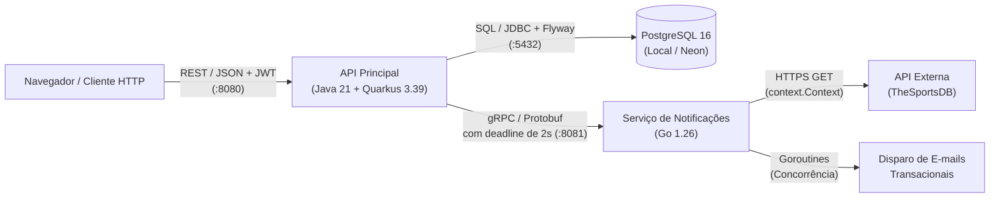

# PalpiteArena ⚽🏆

[](https://github.com/MarceloJoao/PalpiteArena/actions/workflows/ci.yml)
[](LICENSE)

Monorepo da plataforma **PalpiteArena** — sistema de bolões e palpites esportivos onde torcedores apostam em placares de partidas de futebol, acumulam pontos automaticamente e disputam rankings por rodada e temporada.

---

## 👥 Equipe

| Nome | Matrícula | GitHub |
|---|---|---|
| **Antonnione Coelho** | 20250041045 | [@antonionne-coelho](https://github.com/antonionne-coelho) |
| **João Marcelo de Souza** | 20220030819 | [@MarceloJoao](https://github.com/MarceloJoao) |

* **Disciplina:** DIM0547 — Desenvolvimento de Sistemas Web II (2026.2 — UFRN)
* **Docente:** Prof. Francisco Marques Filho

---

## 🎯 O que é o PalpiteArena

Organizar bolões de futebol entre amigos ou comunidades costuma depender de planilhas manuais sujeitas a erros de digitação, atrasos na conferência dos placares oficiais e falta de transparência na atualização do ranking. Além disso, os participantes frequentemente esquecem de registrar seus palpites antes do apito inicial ou demoram para descobrir quantos pontos somaram após o término de cada jogo.

O **PalpiteArena** resolve esse problema oferecendo uma plataforma web e uma API RESTful completas para gerenciar **usuários**, **times**, **partidas** e **palpites**, aplicando regras automáticas de pontuação (**3 pontos** para placar exato, **1 ponto** para acerto do vencedor ou empate e **0 pontos** para erro). Todas as entradas são validadas rigorosamente com retorno padronizado no formato **Problem Details ([RFC 9457](https://datatracker.ietf.org/doc/html/rfc9457))** e autenticação stateless via **JWT (HS256)**.

Na **Sprint 2**, o sistema foi expandido com um microsserviço independente escrito em **Go (`services/notificacao`)**, que se comunica com a API principal em **Java/Quarkus (`api/`)** por meio de **gRPC** com contrato versionado em **Protocol Buffers (`protos/`)**. Esse serviço Go isola o trabalho concorrente de E/S que depende de terceiros — a consulta de placares reais na API externa *TheSportsDB* e o envio assíncrono de notificações por e-mail aos apostadores — garantindo que lentidões ou quedas externas nunca derrubem a API principal.

---

## 📐 Arquitetura do Sistema

O diagrama abaixo ilustra os serviços do monorepo e os protocolos pelos quais eles conversam (**REST/JSON**, **gRPC/Protobuf**, **SQL/JDBC** e **HTTPS**):



* **API Principal (`api/`):** Java 21, Quarkus 3.39.1, Hibernate ORM com Panache, migrações Flyway (`V1` a `V5`), Bean Validation, Problem Details (RFC 9457), SmallRye OpenAPI/Swagger UI, SmallRye Health (`/q/health`) e cliente gRPC (`quarkus-grpc`).
* **Serviço Go (`services/notificacao/`):** Go 1.26, servidor gRPC (`google.golang.org/grpc`) com *Health Checking Protocol* (`grpc_health_v1`), *Server Reflection*, encerramento gracioso (`GracefulStop` no `SIGTERM`), *goroutines* concorrentes e respeito estrito a `context.Context`.
* **Contrato (`protos/`):** Protocol Buffers (`proto3`) no pacote `arenapro.notificacao.v1`, validado com `buf lint` (`STANDARD` e `COMMENTS`).

### Decisões de Arquitetura (ADRs)
* 📄 **[ADR 01 — Responsabilidade do Microsserviço de Notificações e Resultados em Go](docs/decisoes/ADR-01-responsabilidade-servico-go.md)**
* 📄 **[ADR 02 — Estratégia de Implantação em Nuvem (Render, Neon e GHCR)](docs/decisoes/ADR-02-implantacao.md)**

---

## 🌐 No Ar (Produção)

A API principal está publicada em container no **Render** conectada a um banco **PostgreSQL gerenciado no Neon** (conforme detalhado na [ADR-02](docs/decisoes/ADR-02-implantacao.md)):

* 🔗 **URL Pública da API / Interface Web:** [https://palpitearena-api.onrender.com](https://palpitearena-api.onrender.com)
* 📖 **Swagger UI (Interativo no ar):** [https://palpitearena-api.onrender.com/q/swagger-ui](https://palpitearena-api.onrender.com/q/swagger-ui)
* 📄 **Especificação OpenAPI (JSON/YAML no ar):** [https://palpitearena-api.onrender.com/q/openapi](https://palpitearena-api.onrender.com/q/openapi)
* 🩺 **Health Check (Liveness + Readiness do Banco):** [https://palpitearena-api.onrender.com/q/health](https://palpitearena-api.onrender.com/q/health)

> **Nota sobre o plano gratuito:** No plano gratuito do Render, a instância hiberna após 15 minutos sem tráfego; a primeira requisição pode levar cerca de 30 a 50 segundos para iniciar (*cold start*). Conforme documentado na [ADR-02](docs/decisoes/ADR-02-implantacao.md), a API em produção opera com **degradação graciosa** sem o serviço Go (que roda junto da API no `docker compose`).

---

## 🛠️ Pré-requisitos

Para subir todo o sistema do zero via containers, **basta ter o Docker instalado**:

| Ferramenta | Versão Recomendada | Finalidade |
|---|---|---|
| **Docker** & **Docker Compose** | Docker `24+` / Compose `v2+` | Subir banco, serviço Go e API em containers (obrigatório) |
| **Java (JDK)** | `21` (Eclipse Temurin) | *Opcional* — apenas para rodar a API fora do Docker |
| **Go** | `1.23+` / `1.26` | *Opcional* — apenas para rodar o serviço Go fora do Docker |
| **Buf CLI** | `1.47+` | *Opcional* — apenas para validar/regenerar `.proto` localmente |
| **mise** | `2026+` | *Opcional* — executor de tarefas (`mise.toml`) |

---

## 🚀 Como Rodar

### 1. Subir tudo com um único comando (`docker compose`)

Num clone limpo do repositório, **sem precisar criar arquivo `.env` nem instalar Java ou Go**, execute na raiz do projeto:

```bash
docker compose up --build -d
```

O Docker Compose irá:
1. Subir o banco **PostgreSQL 16** (`db`) e aguardar o `pg_isready` ficar saudável (`healthy`);
2. Compilar o **serviço Go** (`notificacao`) em dois estágios (`golang:1.26` → `distroless/static:nonroot`, ~25 MB) e aguardar o health check gRPC (`/notificacao saude` → `SERVING`);
3. Compilar a **API Quarkus** (`api`) em dois estágios (`eclipse-temurin:21-jdk` → `eclipse-temurin:21-jre`), aplicar automaticamente as migrações Flyway (`V1` a `V5`) e aguardar `GET /q/health` responder `UP`.

Para conferir que todos os 3 serviços estão saudáveis (`healthy`):

```bash
docker compose ps
```

Saída esperada:
```text
NAME                         STATUS                   PORTS
palpitearena-db-1            Up (healthy)             0.0.0.0:5432->5432/tcp
palpitearena-notificacao-1   Up (healthy)             0.0.0.0:8081->8081/tcp
palpitearena-api-1           Up (healthy)             0.0.0.0:8080->8080/tcp
```

* 🌐 **Aplicação / Front-end:** [http://localhost:8080](http://localhost:8080)
* 📖 **Swagger UI Local:** [http://localhost:8080/q/swagger-ui](http://localhost:8080/q/swagger-ui)
* 📄 **OpenAPI Local:** [http://localhost:8080/q/openapi](http://localhost:8080/q/openapi)
* 🩺 **Health Check Local:** [http://localhost:8080/q/health](http://localhost:8080/q/health)

Para encerrar os containers:
```bash
docker compose down
```

### 2. Variáveis de Ambiente

O `docker-compose.yml` já possui valores padrão prontos para uso local. Caso queira customizar, copie o arquivo [`.env.example`](.env.example) para `.env`:

```bash
cp .env.example .env
```

| Variável | Padrão Local / Compose | Descrição |
|---|---|---|
| `DATABASE_URL` | `jdbc:postgresql://localhost:5432/palpitearena` | URL JDBC do PostgreSQL (no Neon, inclui `?sslmode=require`) |
| `DATABASE_USER` | `postgres` | Usuário do banco de dados |
| `DATABASE_PASSWORD` | `postgres` | Senha do banco de dados |
| `NOTIFICACAO_HOST` | `localhost` (`notificacao` no compose) | Host do servidor gRPC em Go |
| `NOTIFICACAO_PORT` | `8081` | Porta TCP do servidor gRPC em Go |
| `PORT` / `API_PORT` | `8080` | Porta HTTP onde a API Quarkus escuta |
| `JWT_SECRET` | *(chave padrão de dev)* | Segredo HMAC-SHA256 para assinatura de tokens JWT |

### 3. Aplicar migrações por comando / task

Além da migração automática na subida, é possível aplicar as migrações Flyway e encerrar imediatamente por comando dedicado:

```bash
# Via mise
mise run migrar

# Ou via container Docker
docker compose run --rm api /app/migrar
```

---

## 🧪 Como Testar

A suíte de testes roda localmente e no GitHub Actions CI com a mesma configuração:

### 1. Testes da API Principal (Quarkus / Java 21)

Com o banco PostgreSQL acessível (por exemplo, `docker compose up -d db`):

```bash
cd api
./gradlew test
```
*(No Windows PowerShell: `.\gradlew.bat test` ou na raiz: `mise run test:api`)*

**O que a suíte da API cobre (66 testes):**
* **Unitários de Domínio (`DominioPalpitePartidaTest`):** Regras de cálculo de pontos (`Palpite.calcularPontos`: 3, 1 e 0 pts), formatação de partidas, papéis de usuário e emissão/validação de tokens JWT (`GeradorTokenJwt`) em JUnit 5 puro, sem banco e sem subir o Quarkus.
* **Unitários de Casos de Uso com Dublês em Memória (`PartidaApuracaoUnitarioTest`, `AutenticacaoUnitarioTest`):** Testam apuração de partidas, consulta externa e login JWT usando repositórios e `NotificadorPalpite` falsos em memória.
* **Cliente gRPC em Memória (`NotificadorPalpiteGrpcTest`):** Exercita o adaptador `NotificadorPalpiteGrpc` contra um servidor gRPC real em memória (`InProcessServer`), cobrindo sucesso, *deadline* excedido (`DEADLINE_EXCEEDED`), servidor fora do ar (`UNAVAILABLE`) e argumento inválido (`INVALID_ARGUMENT`).
* **Integração com PostgreSQL Real (`CrudIntegracaoTest`):** Testa o ciclo completo de CRUD (`Time`, `Usuario`, `Partida` e `Palpite`), relacionamentos, paginação (`?pagina=&tamanho=`), filtros (`?status=`, `?usuarioId=`, `?partidaId=`) e apuração no banco PostgreSQL com migrações Flyway.
* **Validação e OpenAPI (`ValidacaoErrosOpenApiTest`, `GreetingResourceTest`):** Verifica respostas de erro no padrão RFC 9457 (`application/problem+json`), publicação do `/q/openapi` e `/q/health/live`.
* **Teste de Arquitetura (`ArchitectureTest`):** Regra **ArchUnit** garantindo que o pacote `..domain..` não depende de HTTP (`jakarta.ws.rs`), persistência (`..repository..`, `java.sql`), runtime Quarkus nem gRPC/Protobuf (`io.grpc..`, `com.google.protobuf..`), incluindo teste explícito que detecta a classe `DominioContaminado` de propósito.

### 2. Testes do Microsserviço Go e Lint do Contrato Protobuf

```bash
# Testes de domínio (respeito a context/deadline, erros) e integração gRPC (bufconn)
cd services/notificacao
go test -v ./...

# Lint do contrato Protocol Buffers (regras STANDARD e COMMENTS)
cd ../../protos
buf lint
```

---

## 💻 Exemplos de Chamadas à API (`curl`)

### 1. Cadastrar um Time (`POST /times`)

```bash
curl -i -X POST http://localhost:8080/times \
  -H "Content-Type: application/json" \
  -d '{"nome": "Flamengo", "escudoUrl": "https://exemplo.com/flamengo.png"}'
```

**Resposta esperada (`201 Created`):**
```json
{
  "id": 1,
  "nome": "Flamengo",
  "escudoUrl": "https://exemplo.com/flamengo.png"
}
```

### 2. Cadastrar um Usuário e Autenticar com JWT (`POST /usuarios` e `POST /auth/login`)

```bash
curl -s -X POST http://localhost:8080/usuarios \
  -H "Content-Type: application/json" \
  -d '{"nome": "Antonnione Coelho", "email": "antonnione@ufrn.edu.br", "senha": "senha123"}'

curl -s -X POST http://localhost:8080/auth/login \
  -H "Content-Type: application/json" \
  -d '{"email": "antonnione@ufrn.edu.br", "senha": "senha123"}'
```

**Resposta esperada (`200 OK`):**
```json
{
  "token": "eyJhbGciOiJIUzI1NiIsInR5cCI6IkpXVCJ9...",
  "tipo": "Bearer",
  "expiraEmSegundos": 86400,
  "usuarioId": 1,
  "nome": "Antonnione Coelho",
  "email": "antonnione@ufrn.edu.br",
  "papel": "TORCEDOR"
}
```

### 3. Apurar Resultado de Partida e Disparar Notificações gRPC (`POST /partidas/{id}/apurar`)

```bash
curl -i -X POST http://localhost:8080/partidas/1/apurar \
  -H "Content-Type: application/json" \
  -d '{"placar": "2x1"}'
```

**Resposta esperada (`200 OK`):** Atualiza a partida para `FINALIZADA`, calcula os pontos de todos os palpites registrados, soma na `pontuacaoTotal` de cada usuário e aciona o microsserviço Go via gRPC (com *deadline* de 2s) para enviar os e-mails de resultado.

### 4. Exemplo de Erro Padronizado — Problem Details ([RFC 9457](https://datatracker.ietf.org/doc/html/rfc9457))

```bash
curl -i -X POST http://localhost:8080/palpites \
  -H "Content-Type: application/json" \
  -d '{}'
```

**Resposta esperada (`400 Bad Request` — `application/problem+json`):**
```json
{
  "type": "/problems/validation-error",
  "title": "Dados de entrada inválidos",
  "status": 400,
  "detail": "Um ou mais campos são inválidos. Veja 'errors' para os detalhes.",
  "instance": "/palpites",
  "errors": [
    { "campo": "partidaId", "mensagem": "não deve ser nulo" },
    { "campo": "placarprevisto", "mensagem": "não deve estar em branco" },
    { "campo": "usuarioId", "mensagem": "não deve ser nulo" }
  ]
}
```

---

## 🎥 Vídeos de Demonstração

* 🎬 **Sprint 2 (Produto Final, Microsserviço Go/gRPC, Compose e Implantação):** *(Link do vídeo de 5 minutos da Sprint 2)*
* 🎬 **Sprint 1 (API, Persistência, Validação e Testes):** [Apresentação Sprint 1 (Google Drive)](https://drive.google.com/file/d/1AixQI5D8RF-haknZz9uLRsh3ehOi13NP/view?usp=sharing)
* 🎬 **Sprint 0 (Proposta e Arquitetura):** [Apresentação da Proposta (Google Drive)](https://drive.google.com/file/d/15e5muSmkTPvpq0RxuDOFyqRg6K2rqs8r/view?usp=sharing)

---

## 📄 Licença

Este projeto é distribuído sob a licença **MIT**. Consulte o arquivo [LICENSE](LICENSE) na raiz do repositório para mais detalhes.
